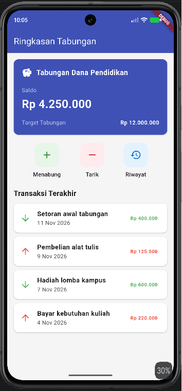
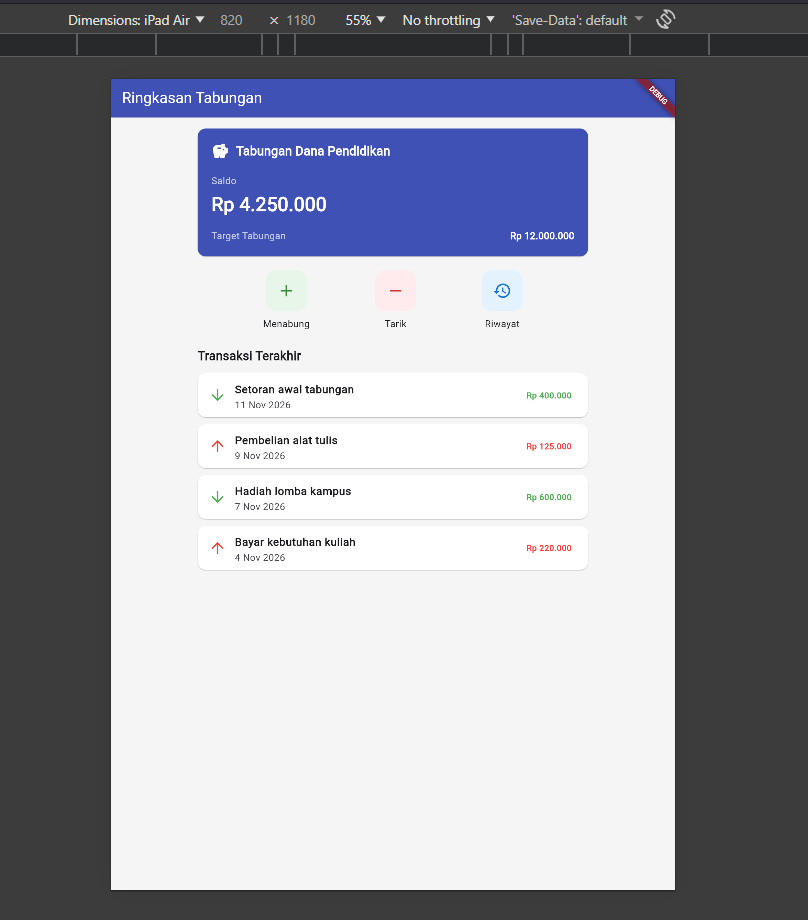

# TabungKu Layout

Layar **Ringkasan Tabungan** untuk aplikasi TabungKu, dibuat menggunakan Flutter dengan widget dasar tanpa menggunakan package pihak ketiga.

## Data Mahasiswa

| **Keterangan** | **Informasi** |
|---|---|
| **Nama** | Michael Cornelius Bong |
| **NIM** | 20240801004 |
| **Mata Kuliah** | Pemrograman Mobile |
| **Tugas** | Menyusun Layout dengan Widget Dasar Flutter |
| **Nama Proyek** | TabungKu Layout |

## Ringkasan

Proyek ini merupakan implementasi tampilan halaman utama aplikasi TabungKu, yaitu `RingkasanPage`. Halaman ini menampilkan informasi tabungan yang terdiri dari nama tabungan, saldo, target tabungan, kategori, dan daftar transaksi terakhir.

Seluruh data yang digunakan bersifat statis (*hard-coded*) karena fokus praktikum adalah penerapan widget dan penyusunan layout, bukan pengelolaan data secara dinamis.

## Tampilan

| Ponsel (Portrait) | Tablet |
|:---:|:---:|
|  |  |

Dokumentasi menampilkan aplikasi pada dua ukuran layar, yaitu ponsel dan tablet. Layout menggunakan pengaturan lebar konten dan scrolling agar tampilan tetap terorganisasi pada ukuran layar yang berbeda.

## Isi Halaman

- **AppBar** menampilkan judul "Ringkasan Tabungan".
- **Kartu Tabungan** (`Card`) menampilkan nama tabungan, saldo, dan target tabungan dengan warna utama Indigo.
- **Tiga Kategori** disusun dalam satu baris (`Row`), yaitu Menabung, Tarik, dan Riwayat.
- **Daftar Transaksi Terakhir** menampilkan empat transaksi yang masing-masing berisi judul, tanggal, nominal, dan ikon.
- **Penanda Transaksi** menggunakan warna hijau untuk transaksi masuk dan merah untuk transaksi keluar.

## Struktur Layout

```text
MaterialApp
└── RingkasanPage
    └── Scaffold
        ├── AppBar
        │   └── Text
        └── body: Center
            └── Container (lebar 600)
                └── Padding
                    └── Column
                        ├── _KartuTabungan
                        │   └── Card
                        │       └── Padding
                        │           └── Column
                        │               ├── Row
                        │               │   └── Icon
                        │               │   └── Expanded
                        │               │       └── Text
                        │               ├── Text (Saldo)
                        │               ├── Text (Nominal saldo)
                        │               └── Row
                        │                   ├── Text (Label target)
                        │                   └── Text (Nominal target)
                        ├── SizedBox
                        ├── _BarisKategori
                        │   └── Row
                        │       └── 3 x _ItemKategori
                        │           └── Column
                        │               ├── Container
                        │               │   └── Icon
                        │               └── Text
                        ├── Text (Transaksi Terakhir)
                        └── Expanded
                            └── ListView.builder
                                └── _ItemTransaksi
                                    └── Card
                                        └── ListTile
                                            ├── leading: Icon
                                            ├── title: Text
                                            ├── subtitle: Text
                                            └── trailing: Text
```

## Peran Tiap Widget

| Widget | Dipakai untuk |
|---|---|
| `MaterialApp` | Mengatur konfigurasi utama aplikasi dan tema. |
| `Scaffold`, `AppBar` | Menyediakan kerangka halaman dan judul aplikasi. |
| `Card` | Membuat kartu ringkasan tabungan dan setiap item transaksi. |
| `Padding` | Memberikan jarak antara isi dan tepi widget. |
| `Container` | Mengatur lebar konten serta membuat kotak ikon dengan warna dan sudut membulat. |
| `Column` | Menyusun elemen secara vertikal. |
| `Row` | Menyusun elemen secara horizontal. |
| `Expanded` | Menggunakan ruang yang tersedia di dalam Row atau Column. |
| `SizedBox` | Memberikan jarak horizontal dan vertikal antarelemen. |
| `Text`, `Icon` | Menampilkan informasi teks dan ikon. |
| `ListView.builder` | Menampilkan daftar transaksi secara dinamis berdasarkan jumlah data dan mendukung scrolling. |
| `ListTile` | Menyusun informasi transaksi dalam satu baris. |
| `Center` | Memposisikan konten di tengah area yang tersedia. |
| `BoxDecoration` | Mengatur warna latar belakang dan sudut membulat pada Container. |

Pengaturan posisi dan jarak menggunakan properti `padding`, `margin`, `width`, `alignment`, `mainAxisAlignment`, dan `crossAxisAlignment`.

## Strategi Agar Tidak Overflow

1. **Center dan Container** - Konten diposisikan di tengah dan memiliki lebar yang diminta sebesar 600 logical pixels. Pada layar yang lebih kecil, ukurannya mengikuti batas ruang yang tersedia dari parent.
2. **Column dan Expanded** - Expanded memberikan sisa ruang halaman kepada daftar transaksi.
3. **ListView.builder** - Daftar transaksi dapat digulir apabila seluruh item tidak muat dalam tinggi layar.
4. **Expanded pada Row** - Digunakan pada bagian nama tabungan agar teks dapat menyesuaikan ruang horizontal yang tersedia.
5. **ListTile** - Menyediakan susunan standar untuk ikon, judul, tanggal, dan nominal transaksi.

## Cara Menjalankan

Prasyarat: Flutter SDK sudah terpasang dan perangkat atau emulator tersedia. Periksa instalasi dengan:

```bash
flutter doctor
```

**1. Clone repository**

```bash
git clone https://github.com/MichaelCorneliusBong/TabungKuLayout.git
```

**2. Masuk ke direktori proyek**

```bash
cd TabungKuLayout
```

**3. Mengunduh dependensi**

```bash
flutter pub get
```

**4. Menjalankan aplikasi**

```bash
flutter run
```

## Struktur Proyek

```text
tabungku_layout/
├── lib/
│   └── main.dart
├── docs/
│   ├── screenshot_handphone.png
│   └── screenshot_tablet.png
├── android/
├── ios/
├── pubspec.yaml
├── pubspec.lock
└── README.md
```
<div align="center">

**Dibuat oleh Michael Cornelius Bong** · Teknik Informatika, Universitas Esa Unggul

</div>
